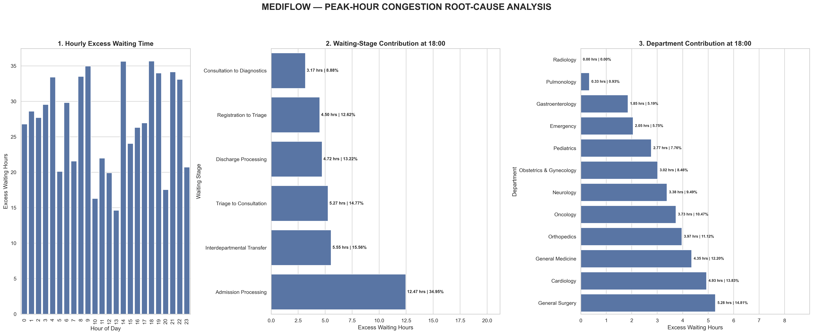
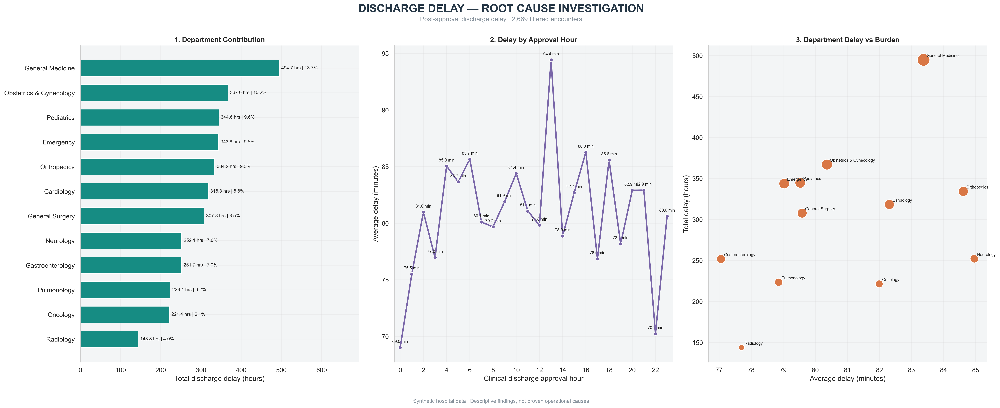
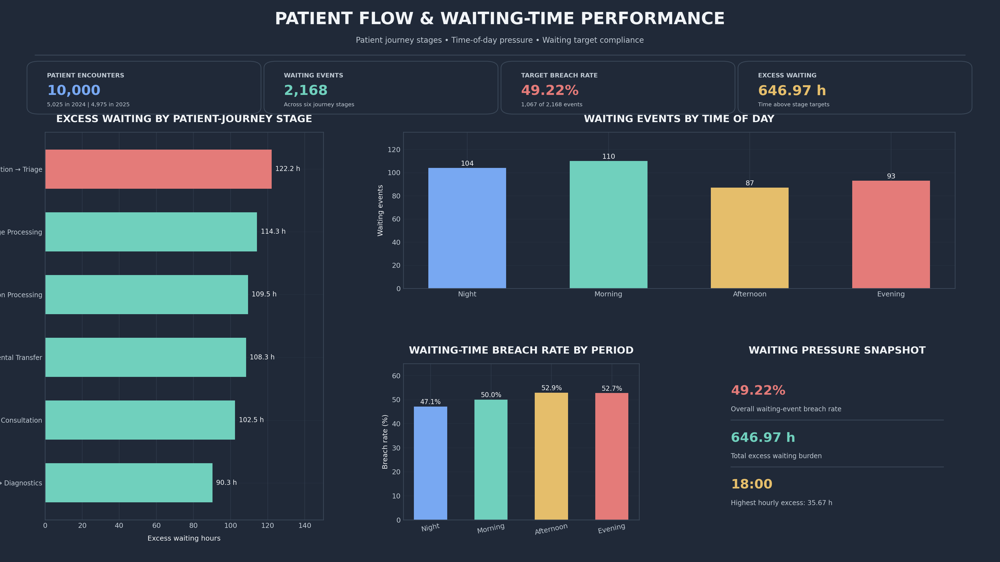
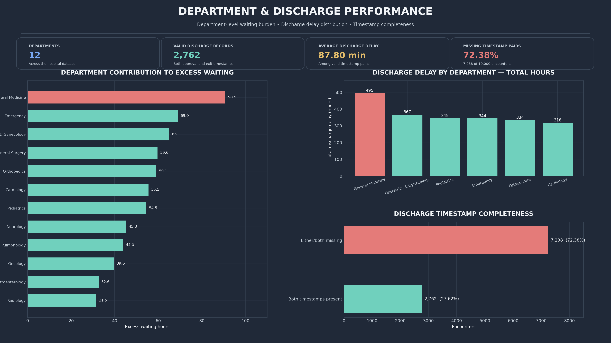
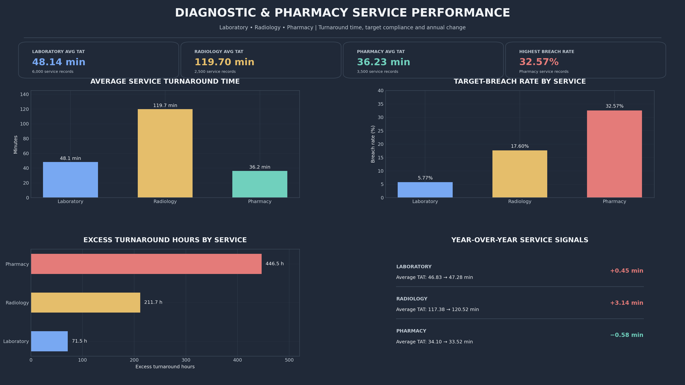

# MediFlow | Hospital Operations & Patient Flow Analytics

## Project Overview

MediFlow is a hospital operations analytics project designed to identify patient-flow bottlenecks, waiting-time patterns, department-level performance issues, discharge delays, and service turnaround inefficiencies.

The project uses **Python, SQL, and Power BI** concepts to transform hospital operational data into meaningful insights that can support better operational decisions.

**Objective:** Identify where delays occur, quantify their impact, and highlight the areas that require further operational investigation.

## Dataset Overview

The project uses a synthetic hospital dataset containing **12 CSV files** and approximately **40,000 records** across multiple operational areas.

The datasets cover:

- Patients and encounters
- Departments and doctors
- Patient waiting events
- Laboratory and radiology services
- Pharmacy operations
- Operation theatre records
- Bed management
- Insurance and admission-discharge-transfer records

The dataset covers **2024 and 2025**.

## Analytical Findings & Root Cause Analysis

### 1. Patient Waiting-Time Analysis

- Analysed 2,168 waiting events.
- Identified a **49.22% target breach rate**.
- Recorded approximately **646.97 hours of excess waiting time**.
- Registration to Triage contributed the highest recorded excess waiting burden at 122.15 hours.

**Business Impact:** Helps identify high-burden waiting stages and prioritize workflow investigation.

### 2. Department Performance Analysis

- General Medicine recorded the highest excess waiting burden at approximately **90.87 hours**.
- Emergency and Pediatrics recorded some of the highest department-level target breach rates.
- Department-level analysis highlighted specific stages requiring further investigation.

**Business Impact:** Helps management prioritize departments and processes for operational review.

### 3. Peak-Hour Congestion Analysis

- Patient arrivals peaked at 08:00 and 23:00.
- Waiting events peaked at 14:00.
- The highest excess waiting burden occurred at 18:00, reaching approximately **35.67 hours**.
- Admission Processing contributed the largest share of the 18:00 excess waiting burden.

**Business Impact:** Helps identify periods of elevated waiting pressure and supports further investigation of resource allocation.

### 4. Discharge Delay Analysis

- Analysed 2,762 encounters with valid clinical discharge approval and actual exit timestamps.
- Average post-approval discharge delay was approximately **87.80 minutes**.
- General Medicine recorded the highest cumulative discharge delay burden.
- 13:00 approval hour recorded the highest average delay among the analysed approval hours.

**Business Impact:** Helps identify departments and time periods that warrant closer examination of discharge processes.

### 5. Service Turnaround-Time Analysis

- Analysed laboratory, radiology, and pharmacy turnaround performance.
- Pharmacy recorded the highest target breach rate at **32.57%**.
- Pharmacy contributed approximately **446.53 excess turnaround hours**.
- Radiology recorded the highest average turnaround time at approximately 119.70 minutes.

**Business Impact:** Helps compare service performance, identify turnaround bottlenecks, and prioritize services for improvement.

### 6. Year-wise Performance Analysis (2024 vs 2025)

- Compared operational performance across 2024 and 2025.
- Average waiting time increased from **47.55 to 49.66 minutes**.
- Waiting-time breach rate increased from **46.28% to 49.43%**.
- Radiology turnaround performance worsened across all four analysed modalities.
- Pharmacy recorded a reduction in total excess turnaround hours.

**Business Impact:** Helps track year-over-year performance changes and identify areas where operational performance requires attention.

## Business Questions

The analysis addresses six key business questions:

1. Which patient journey stages contribute most to waiting-time delays and target breaches?
2. Which departments experience the highest waiting-time burden and poorest performance?
3. During which hours does patient congestion increase, and which stages contribute most to the pressure?
4. Which departments and time periods record the highest post-approval discharge delays?
5. Which hospital services and service categories have the highest turnaround times and target breaches?
6. How did hospital operational performance change between 2024 and 2025?

## SQL Analysis

SQL was used to analyse hospital operations across the six business problem areas, including waiting times, department performance, peak-hour congestion, discharge delays, service turnaround, and year-wise comparisons.

The SQL analysis queries are available here:

[View SQL Analysis Queries](sql/analysis_queries.sql)

## Dashboard Previews

The following static dashboard previews bring together key operational KPIs, department performance, patient waiting patterns, discharge indicators, and service turnaround metrics.

### 1. Patient Flow & Waiting-Time Dashboard

### 2. Department Performance & Discharge Dashboard

### 3. Service Turnaround Dashboard

## Data Quality Limitations

- A substantial proportion of encounters have missing clinical discharge approval and actual exit timestamps.
- Some waiting-event timestamps and encounter timestamps are inconsistent.
- Overlapping waiting events and unmatched diagnostic orders require further validation.
- The dataset is synthetic; findings represent analytical patterns in the generated data and should not be interpreted as actual hospital performance.

## Tools & Technologies

**Python | Pandas | NumPy | Matplotlib | Seaborn | MySQL | Power BI | GitHub**

---

*Developed as a hospital operations analytics portfolio project.*
