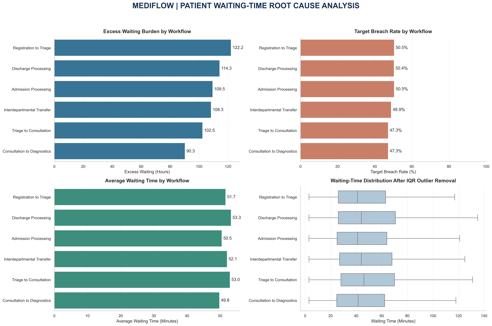
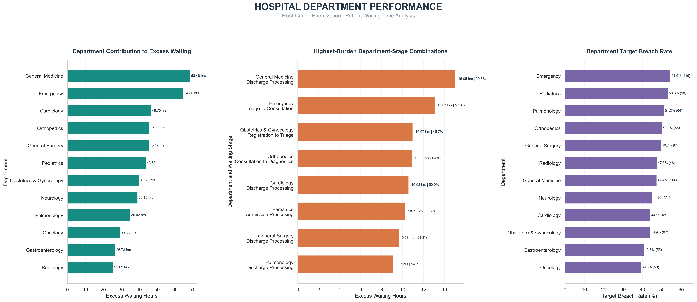
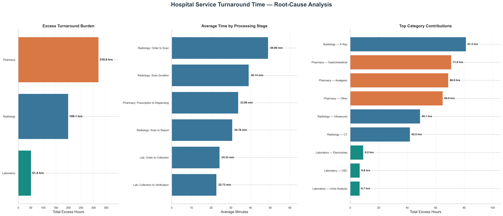
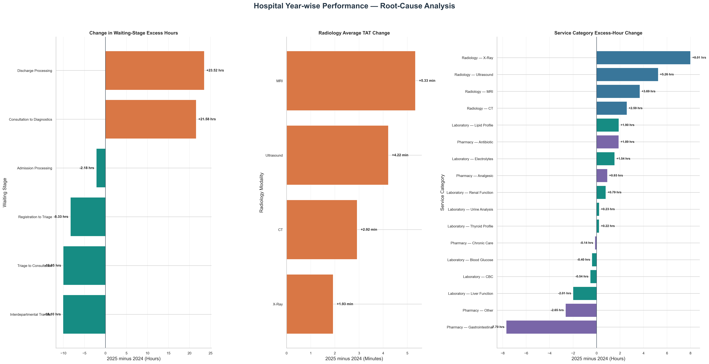

# MediFlow | Hospital Operations & Patient Flow Analytics

**Turning hospital operational data into meaningful insights through SQL-driven analysis and Power BI reporting.**

MediFlow is an end-to-end hospital operations analytics project focused on understanding patient flow, identifying waiting-time bottlenecks, evaluating department performance and analysing clinical-service efficiency.

The objective is to investigate where operational delays accumulate across the patient journey, quantify their impact and identify areas that hospital management should prioritise for further investigation.

---

## Dataset Overview

The project uses **12 interconnected synthetic hospital datasets**, containing **10,000 patient encounters across 2024 and 2025**.

The dataset covers:

- Patient and encounter information
- Departments and doctors
- Patient waiting events
- Laboratory records
- Radiology records
- Pharmacy records
- Operating theatre records
- Bed occupancy
- Insurance records
- Admission, discharge and transfer events (ADT)

This provides a connected view of hospital operations, from patient arrival and waiting to diagnostics, treatment and discharge.

---

## Analytical Dashboards & Key Findings

Six analytical views were developed to identify operational bottlenecks, measure performance and highlight areas requiring further investigation.

### 01. Patient Waiting-Time Analysis

**Key finding:** 49.22% of recorded waiting events breached their targets, resulting in 646.97 cumulative excess waiting hours.

**Business impact:** Identifies patient-journey stages with the greatest waiting burden and helps prioritise workflow investigations.

### 02. Department Performance Analysis

**Key finding:** General Medicine recorded the highest department-level excess waiting burden at 90.87 hours.

**Business impact:** Helps hospital management identify departments that require closer operational review.

### 03. Peak-Hour Congestion Analysis

**Key finding:** 18:00 recorded the highest hourly excess waiting burden at 35.67 hours.

**Business impact:** Highlights periods of increased waiting pressure for further investigation of resource allocation and patient-flow processes.

### 04. Discharge Delay Analysis

**Key finding:** Average discharge approval-to-exit delay was 87.80 minutes among encounters with valid timestamps.

**Business impact:** Provides visibility into the time between clinical discharge approval and actual patient exit.

### 05. Service Turnaround-Time Analysis

**Key finding:** Pharmacy recorded the highest original target-breach rate at 32.57%, with 446.53 excess turnaround hours.

**Business impact:** Helps identify service categories and processes that may require turnaround-time improvement.

### 06. Year-wise Performance Analysis

**Key finding:** Average waiting time increased from 47.55 minutes in 2024 to 49.66 minutes in 2025.

**Business impact:** Enables comparison of operational performance over time and highlights areas where performance has deteriorated or improved.

---

## Six Business Questions

The analysis was structured around six operational questions:

**01. Patient Waiting-Time Bottlenecks**

Where in the patient journey are waiting times accumulating, and which stages contribute the highest target-breach rates?

**02. Department Performance**

Which departments experience the greatest waiting burden, and which department-stage combinations require investigation?

**03. Peak-Hour Congestion**

During which hours does patient waiting pressure peak, and how does it compare with patient arrival volume?

**04. Discharge Delays**

How long does it take patients to leave after clinical discharge approval, and which departments experience the greatest discharge delays?

**05. Service Turnaround Efficiency**

How efficiently do laboratory, radiology and pharmacy services complete their processes against defined turnaround targets?

**06. Year-wise Operational Performance**

How did patient volume, waiting-time performance and service turnaround change between 2024 and 2025?

---

## SQL Business Analysis

MySQL was used to investigate the six business questions and derive operational KPIs from the connected hospital datasets.

The analysis includes:
- Patient waiting-time and target-breach analysis
- Department-level performance comparisons
- Hourly patient congestion analysis
- Discharge delay analysis
- Laboratory, radiology and pharmacy turnaround comparisons
- Year-over-year operational performance analysis

**SQL analysis:** [View complete SQL business queries](sql/analysis_queries.sql)

---

## Power BI Dashboards

The Power BI dashboards provide an executive view of the analytical findings, bringing together operational KPIs, department performance, patient waiting patterns and service turnaround indicators.

*Power BI dashboard screenshots will be added here once the final dashboard images are available.*

---

## Data Quality Limitations

The analysis identified several limitations that influence how the findings should be interpreted:

- **Missing discharge timestamps:** 72.38% of encounters lacked one or both required discharge timestamps.
- **Timestamp inconsistencies:** Some waiting-event timestamps did not align with encounter timestamps.
- **Overlapping waiting events:** Certain records contained overlapping waiting intervals.
- **Diagnostic linkage gaps:** Some waiting events could not be matched to corresponding diagnostic orders.
- **Synthetic data:** Results demonstrate analytical methods and do not represent actual hospital performance.

These limitations were considered during interpretation. The identified high-burden areas are priorities for further investigation, not confirmed operational root causes.

---

**Tools:** MySQL | SQL | Python | Pandas | Data Visualisation | Power BI | GitHub

*Developed as a hospital operations analytics case study for a Data Analyst portfolio.*
