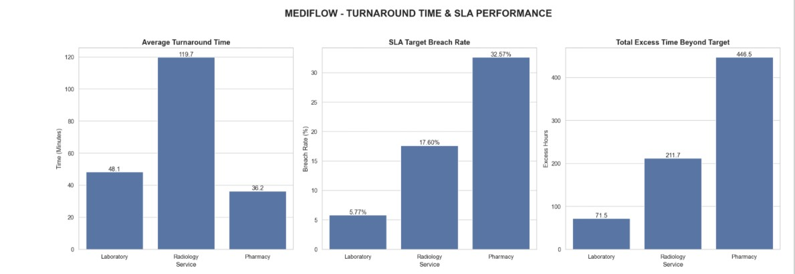
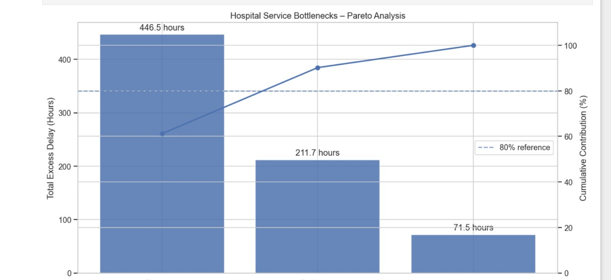

# MediFlow – Hospital Operations & Performance Analytics

An end-to-end **Healthcare Data Analytics project** using Python, SQL, and Power BI to analyse patient flow, waiting times, turnaround times, and hospital resource utilization.

The project examines approximately **40,000 records across 12 synthetic hospital datasets**, covering 2024–2025, to identify operational patterns, quantify bottlenecks, and develop actionable business insights.

> **Note:** This is a synthetic portfolio dataset, not real hospital data.

---

## Project Overview

| Category | Details |
|---|---|
| Domain | Healthcare Analytics |
| Project Type | Exploratory Data Analysis |
| Analysis Period | 2024–2025 |
| Dataset Size | ~40,000 records |
| Data Sources | 12 CSV datasets |
| Programming | Python |
| Analysis | Pandas, NumPy |
| Visualization | Matplotlib, Seaborn |
| Database | SQL |
| Dashboard | Power BI |

## Problem Statement

Hospital operations involve multiple interconnected processes, including registration, consultation, laboratory services, radiology, pharmacy, admission, discharge, and operating theatres.

This project investigates where operational delays occur, which departments experience higher workloads, and which services contribute most to turnaround-time and patient-waiting delays.

## Project Workflow


**Raw Data → Data Cleaning → Python EDA → SQL Analysis → KPI Development → Visualizations → Power BI Dashboard → Business Insights**

---

# Key Insights & Visualizations

## 1. Executive Overview

The executive overview summarizes patient encounters, patient distribution, and department-level activity.


**Key metrics**
- Total encounters: 10,000
- Unique patients: 5,697
- Highest-volume department: General Medicine
- General Medicine encounters: 1,321

## 2. Patient Distribution & Flow Analysis

This analysis examines encounter distribution across departments, encounter types, and patient arrival patterns.


**Key findings**
- Total encounters: 10,000
- Unique patients: 5,697
- Outpatient encounters: 5,756
- Inpatient encounters: 2,769
- Top five departments contributed 52.31% of encounters.
- Outpatient-to-inpatient encounter ratio: 2.08:1, excluding emergency encounters.

## 3. Turnaround Time (TAT) Analysis

TAT measures the time taken to complete laboratory, radiology, and pharmacy services.



| Service | Average TAT | Target Breach Rate |
|---|---:|---:|
| Laboratory | 48.14 min | 5.77% |
| Radiology | 119.70 min | 17.60% |
| Pharmacy | 36.23 min | 32.57% |

**Key findings**
- Pharmacy recorded the highest target-breach rate.
- Pharmacy had 1,140 target breaches.
- Radiology had 440 target breaches.
- Laboratory had 346 target breaches.
- Pharmacy and radiology contributed approximately 90.2% of combined excess delay hours.

## 4. Patient Waiting-Time Analysis

This analysis identifies the waiting stages contributing most to patient delays.


**Key metrics**

| KPI | Result |
|---|---:|
| Valid waiting events | 2,168 |
| Target breaches | 1,067 |
| Breach rate | 49.22% |
| Total excess waiting time | 646.97 hours |
| 95th percentile waiting time | 118 minutes |

**Major waiting-time contributors**

| Waiting Stage | Excess Time |
|---|---:|
| Registration to Triage | 122.15 hours |
| Discharge Processing | 114.27 hours |
| Admission Processing | 109.45 hours |
| Interdepartmental Transfer | 108.35 hours |
| Triage to Consultation | 102.47 hours |
| Consultation to Diagnostics | 90.28 hours |

## 5. Bottleneck & Pareto Analysis

The Pareto analysis identifies which services contribute most to excess turnaround time.



| Service | Excess Delay |
|---|---:|
| Pharmacy | 446.53 hours |
| Radiology | 211.66 hours |
| Laboratory | 71.50 hours |
| **Total** | **729.69 hours** |

**Key finding:** Pharmacy and radiology together account for approximately 90.2% of combined excess delay hours.

# SQL Business Analysis

SQL was used to answer nine operational business questions:

1. Which departments have the highest patient encounter volume?
2. What is the outpatient-to-inpatient encounter ratio?
3. Which services have the highest average turnaround time?
4. Which services have the highest target-breach rates?
5. Which waiting stages contribute the most excess waiting time?
6. Which departments contribute the greatest waiting-time burden?
7. How does doctor workload vary across departments?
8. What patterns exist in operating-theatre start delays?
9. How do selected operational metrics compare across 2024 and 2025?

SQL techniques include:
- Joins
- GROUP BY
- Aggregate functions
- Filtering
- Subqueries
- KPI calculations

SQL scripts are available in the `sql/` folder.

# Python Exploratory Data Analysis

Python was used for:
- Data loading and inspection.
- Missing-value investigation.
- Duplicate identification.
- Timestamp conversion.
- Data cleaning and preparation.
- Statistical analysis.
- KPI calculations.
- Grouping and aggregation.
- Data visualization.

**Libraries:** Pandas, NumPy, Matplotlib, Seaborn.

# Power BI Dashboard

An interactive Power BI dashboard presents operational KPIs, patient flow, service performance, and bottleneck analysis.

Place your exported dashboard screenshots in `powerbi/Dashboard/` and your `.pbix` file in the `powerbi/` directory.

# Business Recommendations

| Observation | Recommended Investigation |
|---|---|
| General Medicine has the highest encounter volume | Review appointment distribution and consultation capacity |
| Pharmacy has the highest breach rate | Investigate prescription queues and dispensing workflow |
| Radiology contributes substantial excess delay | Review reporting workflow and pending studies |
| Registration and discharge have high waiting burdens | Examine process handoffs and administrative steps |
| OT procedures frequently start late | Review scheduling and pre-procedure readiness |
| Bed occupancy coverage is incomplete | Improve ward-level data collection |

These recommendations identify areas for further investigation; they do not establish confirmed root causes.

# Project Limitations

- Dataset is synthetic and does not represent actual hospital operations.
- Target thresholds are dataset-defined, not official hospital SLAs.
- Bed occupancy coverage is incomplete.
- Doctor encounter counts do not account for working hours or clinical complexity.
- OT data does not contain all timestamps needed to calculate true room utilization.
- Descriptive analysis identifies patterns, not proven causes.
- Year-wise comparisons depend on source-data coverage.

# Tools & Technologies

| Tool | Application |
|---|---|
| Python | Data analysis |
| Pandas | Data manipulation |
| NumPy | Numerical analysis |
| Matplotlib | Visualization |
| Seaborn | Statistical charts |
| SQL | Business analysis |
| Power BI | Dashboard reporting |
| Jupyter Notebook | Exploratory analysis |
| VS Code | Development |
| Git & GitHub | Version control |

# Repository Structure

```text
MediFlow-Hospital-Analytics/
├── assets/
│   ├── mediflow_workflow.svg
│   ├── executive.png.jpg
│   ├── Patient Distribution.jpg
│   ├── tat_analysis.jpg
│   ├── Patient Waiting-Time Analysis.jpg
│   ├── bottleneck_analysis.jpg
│   └── yearly_performance.jpg
├── data/
│   ├── raw/
│   └── processed/
├── notebooks/
├── sql/
│   └── analysis_queries.sql
├── Visualizations/
├── powerbi/
├── src/
├── README.md
├── requirements.txt
└── .gitignore
```

# Getting Started

Clone the repository:

```bash
git clone https://github.com/sabaripriyan2004/MediFlow-Hospital-Analytics.git
cd MediFlow-Hospital-Analytics
```

Install dependencies:

```bash
pip install -r requirements.txt
```

Place the CSV datasets in `data/raw/`, run the notebooks, execute the SQL analysis, and open the Power BI report in Power BI Desktop.

---

**MediFlow – Turning Hospital Data into Meaningful Operational Insights.**
